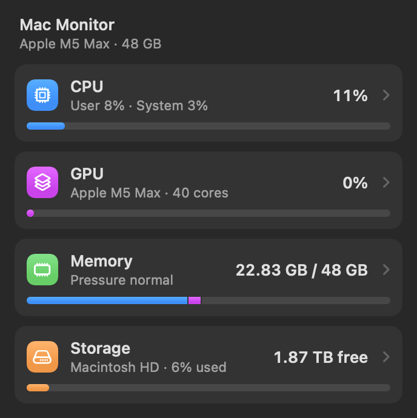
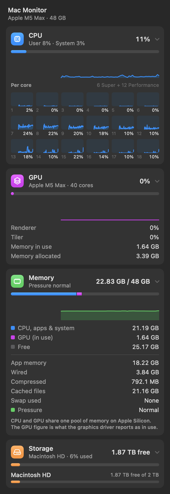
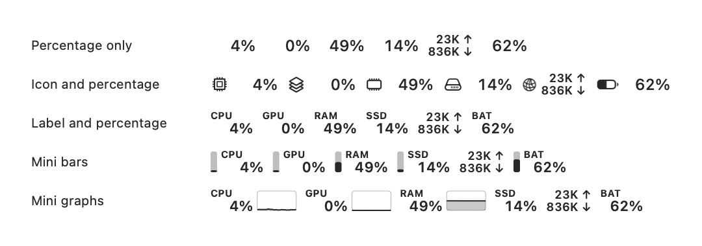

# Mac Monitor

A lightweight, native macOS system monitor for the menu bar, written in SwiftUI. It covers CPU (including per-core usage), GPU, memory (split between CPU and GPU), storage and disk activity, network and battery, and shows which apps are using each one. Click the menu bar item to see everything at a glance, then expand any section for details. An optional desktop widget collapses to rings or expands to the full view, and notifications can warn you when something runs high.

<p>
  
  
</p>

## Features

- **Customizable menu bar item:** shows everything by default (CPU, GPU, memory, storage, network upload and download, and battery). Turn any of them off in Settings, and choose one of five styles: percentage only, icon and percentage, label and percentage, mini bars, or mini graphs. The item follows the menu bar's light and dark appearance.

  

- **Click for an overview:** the panel shows a card for each area. Click a card to expand its details, or use the button in the top-right corner to expand or collapse them all.
  - **CPU:** user and system load, a history graph, per-core graphs for every core (with the number of each core type on Apple Silicon), load average, uptime, thermal state, and the **top apps by CPU**.
  - **GPU:** device, renderer and tiler utilisation, a history graph, the memory the GPU is using, and the **top apps by GPU time**.
  - **Memory:** a split bar of CPU/apps, GPU and free memory; app, wired, compressed and cached memory; swap; memory pressure; and the **top apps by memory**.
  - **Storage:** disk read and write speed with a graph, the **top apps by disk activity**, and every writable volume.
  - **Network:** download and upload speed with a graph, interface, local IP address, totals since startup, and the **top apps by network traffic**.
  - **Battery** (on Macs that have one): level, charging state and time remaining, cycle count, maximum capacity, condition, power adapter, the **top apps by energy impact** (the same figure Activity Monitor shows), and an **Energy Mode switch: Automatic, Low Power or High Power** (High Power on Max-chip MacBook Pros). Automatic is macOS's default. Changing the mode asks for your administrator password, because macOS offers no other way for apps to change it.
- **Steady layout:** numbers use fixed-width slots, so the menu bar item and panel don't shift when a value goes from one to two or three digits.
- **Per-app lists are collected only while their card is expanded**, so Mac Monitor stays light (about 2–4% of one core) the rest of the time.
- **Alerts:** optional macOS notifications for sustained high CPU, memory pressure, low disk space, low battery, or the Mac running hot. Set the limits in Settings › Alerts.
- **Desktop widget (optional):** a widget-style panel that can sit on the desktop behind your windows, float above them, or behave like a normal window. It shows rings when collapsed and the full panel when expanded. Drag it from anywhere on it to put it wherever you like, on any screen; it remembers its position the next time it opens. Hover over it for the expand, settings and close buttons. Click a ring to jump straight to that section's details.

  

- **Native Settings window:** update interval (0.5 to 5 seconds), open at login, menu bar contents and style (with a live preview), widget position, and alerts.
- **Always a way back:** Mac Monitor has no Dock icon. If its menu bar item is hidden (by the Settings switch, by ⌘-dragging it out of the menu bar, or by macOS), open Mac Monitor again from Applications or Spotlight. That brings the item back and opens Settings.
- Uses only public APIs and the standard command-line tools (`ps`, `top`, `nettop`, `netstat`), so it needs no root access, helper tools or kernel extensions.

### Compared with Stats

[Stats](https://github.com/exelban/stats) is the mature open-source option. Mac Monitor now covers its CPU, GPU, memory, disk, network and battery modules, including per-app lists and notifications. Not included: temperature and fan sensors (on Apple Silicon these need private, undocumented Apple interfaces), fan control (needs a privileged helper), Bluetooth device batteries, and the clock module.

### About the CPU and GPU memory split

Apple Silicon Macs have unified memory: the CPU and GPU share one pool of RAM. The GPU figure is the memory the graphics driver reports as in use. That memory is already counted in wired and app memory, so the CPU figure is everything else that's in use.

## Install

**Requirements:** macOS 15 Sequoia or later, on Apple Silicon or Intel.

1. Download `MacMonitor.zip` from the [latest release](https://github.com/lowkeyspectator/mac-monitor/releases/latest).
2. Unzip it and drag **MacMonitor.app** into your **Applications** folder.
3. Open it. The app isn't notarized by Apple, so the first launch is blocked with a message that macOS couldn't verify it. To allow it:
   - Open **System Settings → Privacy & Security**, scroll down to the message about MacMonitor, click **Open Anyway** and confirm. Or
   - run this once in Terminal:
     ```bash
     xattr -dr com.apple.quarantine /Applications/MacMonitor.app
     ```
4. The monitor appears in the menu bar; it has no Dock icon. Click it to see your usage. Use the gear button to open Settings, where you can customize the menu bar, turn on the desktop widget, and set it to open at login.

To uninstall, choose Quit from the panel (the power button) and delete `/Applications/MacMonitor.app`.

## Build from source

You only need the Xcode Command Line Tools (`xcode-select --install`). The full Xcode app isn't required.

```bash
git clone https://github.com/lowkeyspectator/mac-monitor.git
cd mac-monitor
./build.sh          # builds MacMonitor.app (universal binary)
open MacMonitor.app
```

`./build.sh --zip` also creates `MacMonitor.zip` for a release. Apps you build yourself aren't quarantined, so step 3 above doesn't apply to them.

The views can be rendered to PNG files without opening any windows. This is how the screenshots above were made:

```bash
MacMonitor.app/Contents/MacOS/MacMonitor --snapshot docs/
```

## Project layout

| File | Purpose |
| --- | --- |
| `Sources/Sampler.swift` | The `Monitor` model: samples everything once per interval and gathers per-app lists for expanded cards |
| `Sources/Readers.swift` | Network, disk I/O, process list, battery and system readers |
| `Sources/Collectors.swift` | Per-app GPU time, disk I/O, network (`nettop`) and energy (`top`) |
| `Sources/Alerts.swift` | Threshold alerts as macOS notifications |
| `Sources/Prefs.swift` | Default preferences |
| `Sources/Panel.swift` | Expandable metric cards and the shared UI pieces (bars, rings, sparklines) |
| `Sources/MenuBar.swift` | Menu bar label rendering and the menu bar panel |
| `Sources/Widget.swift` | Desktop widget window |
| `Sources/SettingsView.swift` | Settings window |
| `Sources/Snapshot.swift` | `--snapshot` screenshot renderer |
| `Scripts/make-icon.swift` | Generates the app icon |

