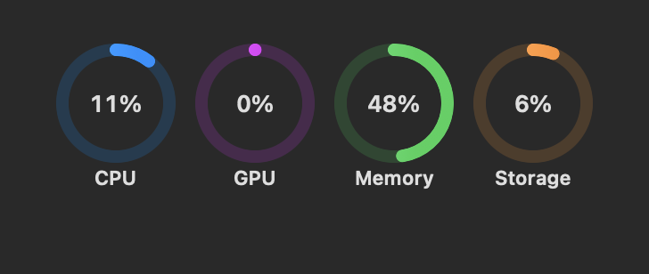

# Mac Monitor

A lightweight, native macOS system monitor for the menu bar, written in SwiftUI. It shows CPU (including per-core usage), GPU, memory (split between CPU and GPU) and storage. Click the menu bar item to see everything at a glance, then expand any section for details. An optional desktop widget collapses to rings or expands to the full view.

<p>
  
  
</p>

## Features

- **Customizable menu bar item:** choose which metrics to show (CPU, GPU, memory, storage) and one of five styles: percentage only, icon and percentage, label and percentage, mini bars, or mini graphs. The item follows the menu bar's light and dark appearance.

  

- **Click for an overview:** the panel shows a card for each metric. Click a card to expand its details, or use the button in the top-right corner to expand or collapse them all.
  - **CPU:** user and system load, a history graph, and per-core graphs for every core. On Apple Silicon it also shows how many cores of each type the chip has.
  - **GPU:** device, renderer and tiler utilisation, a history graph, and the memory the GPU is using.
  - **Memory:** a split bar of CPU/apps, GPU and free memory, plus app, wired, compressed and cached memory, swap and memory pressure.
  - **Storage:** every writable mounted volume.
- **Desktop widget (optional):** a widget-style panel that can sit on the desktop behind your windows, float above them, or behave like a normal window. It shows rings when collapsed and the full panel when expanded. Drag it from anywhere on it to put it wherever you like, on any screen; it remembers its position the next time it opens. Hover over it for the expand, settings and close buttons. Click a ring to jump straight to that section's details.

  

- **Native Settings window:** set the update interval (0.5 to 5 seconds), open at login, menu bar metrics and style (with a live preview), and the widget's position.
- Menu bar only, with no Dock icon. It uses only public APIs (`host_processor_info`, `host_statistics64`, `sysctl`, IOKit `IOAccelerator` statistics), so it needs no root access, helper tools or kernel extensions.

### About the CPU and GPU memory split

Apple Silicon Macs have unified memory: the CPU and GPU share one pool of RAM. The GPU figure is the memory the graphics driver reports as in use. That memory is already counted in wired and app memory, so the CPU figure is everything else that's in use.

## Install

**Requirements:** macOS 15 Sequoia or later, on Apple Silicon or Intel.

1. Download `MacMonitor.zip` from the [latest release](https://github.com/lowkeyspectator/mac-monitor/releases/latest).
2. Unzip it and drag **MacMonitor.app** into your **Applications** folder.
3. Open it. The app isn't notarized by Apple, so the first launch is blocked with a message that macOS couldn't verify it. To allow it:
   - Open **System Settings → Privacy & Security**, scroll down to the message about MacMonitor, click **Open Anyway** and confirm. Or
   - run this once in Terminal:
     ```bash
     xattr -dr com.apple.quarantine /Applications/MacMonitor.app
     ```
4. The monitor appears in the menu bar; it has no Dock icon. Click it to see your usage. Use the gear button to open Settings, where you can customize the menu bar, turn on the desktop widget, and set it to open at login.

To uninstall, choose Quit from the panel (the power button) and delete `/Applications/MacMonitor.app`.

## Build from source

You only need the Xcode Command Line Tools (`xcode-select --install`). The full Xcode app isn't required.

```bash
git clone https://github.com/lowkeyspectator/mac-monitor.git
cd mac-monitor
./build.sh          # builds MacMonitor.app (universal binary)
open MacMonitor.app
```

`./build.sh --zip` also creates `MacMonitor.zip` for a release. Apps you build yourself aren't quarantined, so step 3 above doesn't apply to them.

The views can be rendered to PNG files without opening any windows. This is how the screenshots above were made:

```bash
MacMonitor.app/Contents/MacOS/MacMonitor --snapshot docs/
```

## Project layout

| File | Purpose |
| --- | --- |
| `Sources/Sampler.swift` | Reads CPU ticks, VM statistics, swap, GPU statistics and volumes; publishes them once per interval |
| `Sources/Panel.swift` | Expandable metric cards and the shared UI pieces (bars, rings, sparklines) |
| `Sources/MenuBar.swift` | Menu bar label rendering and the menu bar panel |
| `Sources/Widget.swift` | Desktop widget window |
| `Sources/SettingsView.swift` | Settings window |
| `Sources/Snapshot.swift` | `--snapshot` screenshot renderer |
| `Scripts/make-icon.swift` | Generates the app icon |

## Alternatives

If you want a mature monitor with sensors, network, battery and more, see [Stats](https://github.com/exelban/stats), which is open source.
